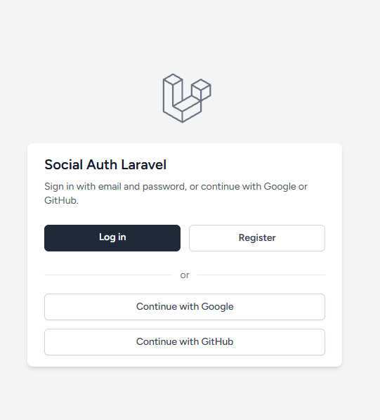
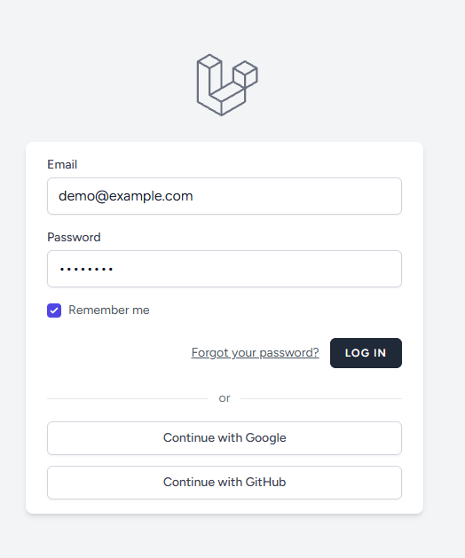
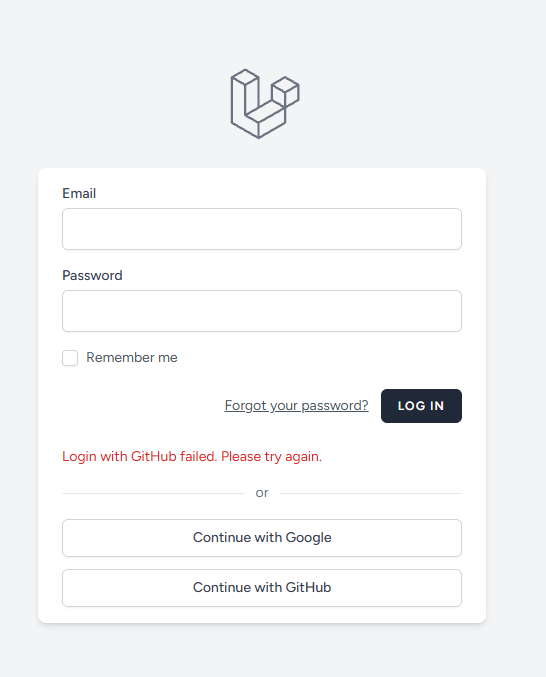
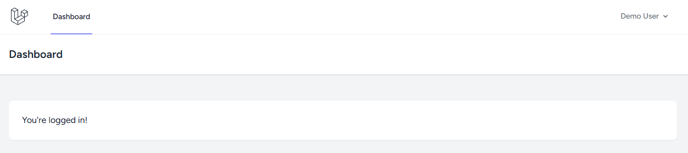

# social-auth-laravel

[](https://github.com/EgeOzcelikk/social-auth-laravel/actions/workflows/tests.yml)

A Laravel 12 app where users can sign in with email and password, or with their Google or GitHub account. It runs with one Docker command and uses SQLite, so there is no database server to set up.



## Problem & question

This is a from-scratch rewrite of LaraForm, an earlier internship project of mine that never worked reliably. Returning OAuth users could not log in again, accounts were not linked by email, and errors were silently swallowed.

The question behind the rewrite: **how do you add social login to a Laravel app so that it is correct and safe, not just working on the happy path?** In particular:

- A user who first registered with a password and later clicks "Continue with Google" should end up in the **same** account.
- An attacker must not be able to take over that account by registering the victim's email first.
- Every failure (cancelled consent, invalid state, missing email) should show the user a clear message and be logged.

## Approach

- **Email/password auth** comes from [Laravel Breeze](https://laravel.com/docs/12.x/starter-kits) (Blade + Tailwind). Email verification is required for password users.
- **OAuth** uses [Laravel Socialite](https://laravel.com/docs/12.x/socialite) with a small `SocialiteController`:
  - Only providers in an allowlist (`google`, `github`) are accepted. Any other `/auth/{provider}` URL returns 404.
  - Linked provider accounts live in their own `social_accounts` table (`user_id`, `provider`, `provider_id`, unique on `provider + provider_id`). One user can have several providers, and `users.password` is nullable for OAuth-only users.
  - **Returning user:** found by `provider + provider_id`, so a changed email at the provider does not break login.
  - **New provider, existing email:** linked to the existing account only if the provider says the email is verified **and** the local account has a verified email. This blocks pre-account hijacking (someone registers your email with a password, then waits for you to log in with Google).
  - **Unknown email:** a new user is created with the email already marked as verified.
  - Provider access tokens are **not stored**, because the app only needs the identity, not API access to the user's Google or GitHub account.
- **Connected accounts** (section on the profile page): logged-in users can connect or disconnect Google and GitHub.
  - Connecting reuses the login callback URL (a GitHub OAuth app allows only one). If the user is logged in, the callback connects the account instead of logging in. No email match is needed, because the user controls both accounts at that moment.
  - At most one account per provider per user (unique on `user_id + provider`). A provider account that belongs to another user is refused.
  - Only users with a verified email can connect accounts (same pre-account hijacking guard as above).
  - Disconnecting is scoped to the user's own accounts (another user's account ID returns 404). The last login method cannot be removed: a user without a password must keep at least one provider.
- **Tests:** Pest feature tests for every step, including the OAuth flows (Socialite is mocked, so tests never call Google or GitHub).
- **CI:** GitHub Actions runs the full test suite on every push and on every pull request to `main`.

## Screenshots

| Login | OAuth error |
|---|---|
|  |  |

Dashboard after login:



## How to run

Requirements: [Docker Desktop](https://www.docker.com/products/docker-desktop/).

```bash
git clone https://github.com/EgeOzcelikk/social-auth-laravel.git
cd social-auth-laravel
docker compose up --build
```

Open http://localhost:8000.

On the first start the container installs PHP and Node dependencies, builds the frontend, creates `.env` from `.env.example`, generates `APP_KEY`, creates the SQLite database and runs the migrations. Later starts skip the steps that are already done.

Email/password login works right away. Emails (verification, password reset) are not sent; with `MAIL_MAILER=log` they are written to `storage/logs/laravel.log`, where you can copy the verification link.

### Enable Google and GitHub login (optional)

Create an OAuth app at each provider and use these callback URLs:

| Provider | Where to create the app | Callback / redirect URL |
|---|---|---|
| Google | [Google Cloud Console](https://console.cloud.google.com/apis/credentials) → Credentials → OAuth client ID (Web application) | `http://localhost:8000/auth/google/callback` |
| GitHub | [GitHub](https://github.com/settings/developers) → Settings → Developer settings → OAuth Apps | `http://localhost:8000/auth/github/callback` |

Then put the client ID and secret into your local `.env` (never commit this file):

```env
GOOGLE_CLIENT_ID=
GOOGLE_CLIENT_SECRET=
GITHUB_CLIENT_ID=
GITHUB_CLIENT_SECRET=
```

Restart with `docker compose restart app` so the new values are loaded.

### Useful commands

```bash
docker compose exec app php artisan test     # run the test suite
docker compose exec app npm run build        # rebuild CSS/JS after changing Blade, CSS or JS
docker compose down                          # stop the app
```

## Tech stack

| Area | Choice |
|---|---|
| Backend | PHP 8.3, Laravel 12 |
| Auth | Laravel Breeze (Blade), Laravel Socialite |
| Frontend | Blade, Tailwind CSS 3, Alpine.js, Vite |
| Database | SQLite |
| Tests | Pest |
| Dev environment | Docker, Docker Compose |
| CI | GitHub Actions |

## Limitations

- **Connecting an account needs no re-authentication.** Anyone with access to an open, logged-in session can connect their own Google or GitHub account to it. A stronger app would ask for the password (or an email code for OAuth-only users) first. This is out of scope for this project.
- **Unverified password accounts are not auto-linked.** If you registered with a password but never verified your email, "Continue with Google" with the same email is refused. You have to verify your email or log in with your password first. This is on purpose (see Approach).
- **OAuth-only users have no password.** They can set one through "Forgot your password?".
- **No real email delivery.** Emails go to the log file; a real mail provider is needed for production.
- **Development setup only.** The Docker setup uses `php artisan serve` and is not meant for production. There is no live demo yet.
- **Only Google and GitHub.** Other providers need a config entry, an allowlist entry and a button.

## License

[MIT](LICENSE)
